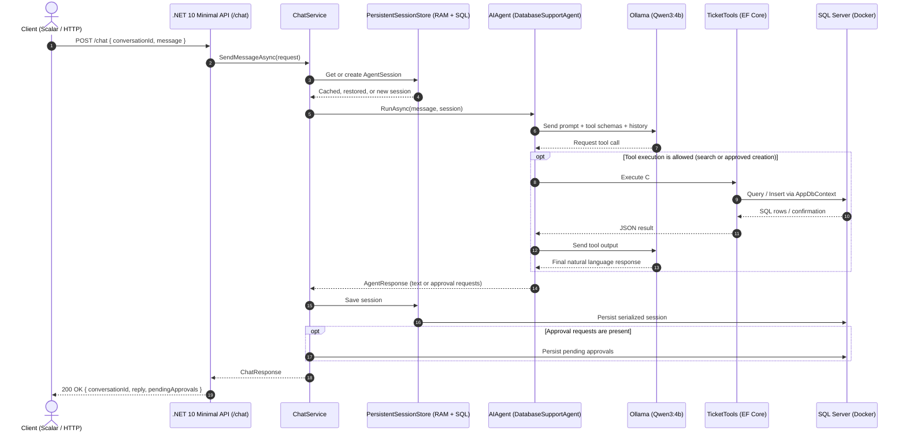

# 02-Radar-Agent-Api

An AI Support Agent built with **.NET 10 Minimal APIs**, **Microsoft.Agents.AI**, **Entity Framework Core**, and **SQL Server**, with the API and database containerized using **Docker Compose**.

The agent manages multi-turn conversations through `conversationId` and interacts with a relational database through custom AI tools (`SearchTickets` and `CreateTicket`), powered by a local **Qwen3:4b** language model running on the host machine through **Ollama**. Creating a ticket requires human approval through `POST /chat/approve`.

## Architecture & Request Flow



## Project Structure

- `02-Radar-Agent-Api/` — .NET 10 Web API, EF Core `AppDbContext`, migrations, `TicketTools`, `Dockerfile`, and `docker-compose.yml`.
- `../radar-agent-api.Tests/` — Sibling xUnit test project using an isolated EF Core In-Memory database, with no LLM dependency.
- `evals.md` — Qualitative evaluation dataset in this project, covering single-turn and multi-turn agent scenarios.

### Responsibilities after the structural refactoring

| File or directory | Responsibility |
| --- | --- |
| `Program.cs` | Application startup, CORS, database registration/migrations, middleware, and endpoint mapping. |
| `Contracts/Chat/` | HTTP request and response records shared with the client through JSON. These are not EF entities. |
| `Endpoints/ChatEndpoints/ChatEndpoints.cs` | Route definitions and translation of service outcomes into HTTP responses. |
| `Services/ChatService.cs` | Conversation orchestration: load session, run agent, save state, and process approvals. |
| `Services/ChatApprovalResult.cs` | Application outcome of an approval; contains no HTTP status codes or results. |
| `Extensions/AgentServiceCollectionExtensions.cs` | `AddRadarAgent`: registers the client, agent, tools, store, and chat service with their lifetimes. |
| `Agents/SupportAgentInstructions.cs` | The agent's instructions, kept separate from application startup. |
| `Agents/Tools/`, `Data/`, `Store/` | Tool implementations, EF persistence, and session storage. |

Read the main flow in this order: `Program.cs` → `ChatEndpoints` → `ChatService` → agent/tools/store. Read `AddRadarAgent` to understand how those dependencies are constructed. The previous `AgentHelpers` response processing now belongs to `ChatService` because it participates in this application flow and writes pending approvals.

This refactoring preserves the existing routes, JSON contracts, messages, prompt/model, DI lifetimes, and order of database writes. Changes to validation, concurrent conversations, approval batching, cache policy, and database transactions are separate follow-up work. In particular, `/chat/raw` retains its existing plain-text behavior and does not persist pending approvals.

`ChatRefactoringTests` exercises the real HTTP endpoints with a scripted `IChatClient` and an isolated EF InMemory database. It covers response contracts, approval/denial, repeated and mismatched approval IDs, session restoration after a host restart, the original prompt, route/OpenAPI metadata, and DI lifetimes. These tests do not require Ollama or SQL Server and do not replace integration testing against SQL Server.

## Getting Started

1. Ensure **Ollama is running on your host machine** with the `qwen3:4b-instruct-2507-q4_K_M` model downloaded.

2. Start the **API and SQL Server** from the `02-Radar-Agent-Api` directory:

   ```bash
   docker compose up --build -d
   ```

3. Open the [Scalar UI](http://localhost:8080/scalar/v1) to test the endpoints.

4. Run the **unit tests** from the same directory:

   ```bash
   dotnet test ../radar-agent-api.Tests/radar-agent-api.Tests.csproj
   ```

### Running from Visual Studio

Start the database before pressing F5:

```powershell
docker compose up -d --wait sqlserver
```

Select the `https` launch profile and press **F5**. Visual Studio opens [Scalar](https://localhost:7215/scalar/v1) automatically; both launch profiles explicitly set `launchBrowser` and `launchUrl`. The `http` profile uses [port 5294](http://localhost:5294/scalar/v1).

The API applies migrations before starting its web server. If SQL Server is stopped, startup cannot complete and Visual Studio may report that the web server failed to listen on port 7215; Scalar and the browser cannot start until the database is available.

## What I Learned

1. **DI Lifetimes with AI Agents:** Since EF Core's `DbContext` is scoped, the tool classes and `AIAgent` that depend on it are also registered as scoped, while `IChatClient` and session storage remain singletons.
2. **Stateful Multi-Turn Conversations:** Passing an `AgentSession` tied to a `conversationId` preserves context across stateless HTTP requests without coupling conversation memory to the agent instance.
3. **Container Networking:** Docker Compose services communicate through service names (`Server=sqlserver`), while host services such as Ollama are reached through `host.docker.internal`.
4. **Automated Schema Provisioning:** Calling `db.Database.Migrate()` at startup applies EF Core migrations and creates the database schema when starting with a fresh SQL Server container.
5. **Deterministic vs. Probabilistic Testing:** Tool business logic can be verified deterministically with xUnit and EF Core In-Memory, while LLM behavior is evaluated separately through the scenarios in `evals.md`.

## Verify the Request and Tool Logs

From a terminal in the `02-Radar-Agent-Api` directory, start the services and follow the API logs:

```bash
docker compose up --build -d
docker compose logs -f api
```

The `-f` flag keeps the terminal attached to the `api` container logs. When the agent invokes a tool, its `Console.WriteLine` output appears here; the tool code also sets console colors for these messages.

Open the [Scalar UI](http://localhost:8080/scalar/v1) and send the following JSON body to **`POST /chat`**:

```json
{
  "conversationId": "final-check",
  "message": "create a ticket for printer issue"
}
```

The `/chat` response contains a pending approval. Send its `requestId` to `POST /chat/approve`, using the same `conversationId`:

```json
{
  "conversationId": "final-check",
  "requestId": "<requestId returned by /chat>",
  "approved": true
}
```

After approval, when the agent invokes `CreateTicket`, look for this prefix in the terminal logs, followed by the ticket title and priority:

```text
[TOOL DB - CreateTickets]: Creazione ticket...
```
