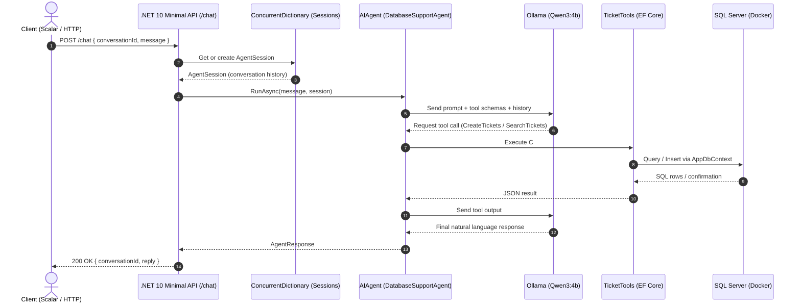

# 02-Radar-Agent-Api

An AI Support Agent built with **.NET 10 Minimal APIs**, **Microsoft.Agents.AI**, **Entity Framework Core**, and **SQL Server**, with the API and database containerized using **Docker Compose**.

The agent manages multi-turn conversations through `conversationId` and interacts with a relational database through custom AI tools (`SearchTickets` and `CreateTickets`), powered by a local **Qwen3:4b** language model running on the host machine through **Ollama**.

## Architecture & Request Flow



## Project Structure

- `02-Radar-Agent-Api/` — .NET 10 Web API, EF Core `AppDbContext`, migrations, `TicketTools`, `Dockerfile`, and `docker-compose.yml`.
- `../radar-agent-api.Tests/` — Sibling xUnit test project using an isolated EF Core In-Memory database, with no LLM dependency.
- `evals.md` — Qualitative evaluation dataset in this project, covering single-turn and multi-turn agent scenarios.

## Getting Started

1. Ensure **Ollama is running on your host machine** with the `qwen3:4b-instruct-2507-q4_K_M` model downloaded.

2. Start the **API and SQL Server** from the `02-Radar-Agent-Api` directory:

   ```bash
   docker compose up --build -d
   ```

3. Open the [Scalar UI](http://localhost:8080/scalar/v1) to test the endpoints.

4. Run the **unit tests** from the same directory:

   ```bash
   dotnet test ../radar-agent-api.Tests/radar-agent-api.Tests.csproj
   ```

## What I Learned

1. **DI Lifetimes with AI Agents:** Since EF Core's `DbContext` is scoped, the tool classes and `AIAgent` that depend on it are also registered as scoped, while `IChatClient` and session storage remain singletons.
2. **Stateful Multi-Turn Conversations:** Passing an `AgentSession` tied to a `conversationId` preserves context across stateless HTTP requests without coupling conversation memory to the agent instance.
3. **Container Networking:** Docker Compose services communicate through service names (`Server=sqlserver`), while host services such as Ollama are reached through `host.docker.internal`.
4. **Automated Schema Provisioning:** Calling `db.Database.Migrate()` at startup applies EF Core migrations and creates the database schema when starting with a fresh SQL Server container.
5. **Deterministic vs. Probabilistic Testing:** Tool business logic can be verified deterministically with xUnit and EF Core In-Memory, while LLM behavior is evaluated separately through the scenarios in `evals.md`.

## Verify the Request and Tool Logs

From a terminal in the `02-Radar-Agent-Api` directory, start the services and follow the API logs:

```bash
docker compose up --build -d
docker compose logs -f api
```

The `-f` flag keeps the terminal attached to the `api` container logs. When the agent invokes a tool, its `Console.WriteLine` output appears here; the tool code also sets console colors for these messages.

Open the [Scalar UI](http://localhost:8080/scalar/v1) and send the following JSON body to **`POST /chat`**:

```json
{
  "conversationId": "final-check",
  "message": "create a ticket for printer issue"
}
```

When the agent invokes `CreateTickets`, look for this prefix in the terminal logs, followed by the ticket title and priority:

```text
[TOOL DB - CreateTickets]: Creazione ticket...
```
