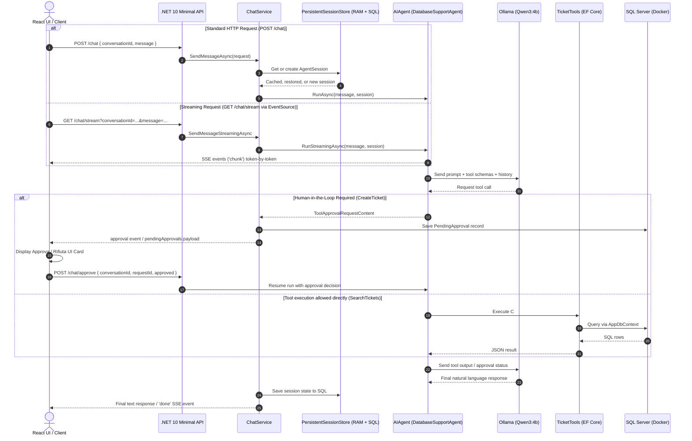

# 02-Radar-Agent-Api

An AI Support Agent built with **.NET 10 Minimal APIs**, **Microsoft.Agents.AI**, **Entity Framework Core**, **SQL Server**, and a **React (TypeScript + Vite)** frontend. The API, database, and Aspire Dashboard are containerized using **Docker Compose**.

The agent manages multi-turn conversations through `conversationId` and interacts with a relational database through custom AI tools (`SearchTickets` and `CreateTicket`), powered by a local **Qwen3:4b** language model running on the host machine through **Ollama**. Creating a ticket requires human approval through `POST /chat/approve` or via the interactive UI card.

## Architecture & Request Flow



## Project Structure

- `02-Radar-Agent-Api/` — .NET 10 Web API, EF Core `AppDbContext`, migrations, `TicketTools`, `Dockerfile`, and `docker-compose.yml`.
- `radar-agent-ui/` — React 18 + TypeScript + Vite UI featuring token streaming, React Query, and human approval cards.
- `../radar-agent-api.Tests/` — Sibling xUnit test project using an isolated EF Core In-Memory database with no LLM dependency.
- `evals.md` — Qualitative evaluation dataset covering single-turn and multi-turn agent scenarios.

### Responsibilities after structural refactoring

| File or directory | Responsibility |
| --- | --- |
| `Program.cs` | Application startup, CORS policies, database registration/migrations, OpenTelemetry, and endpoint mapping. |
| `Contracts/Chat/` | HTTP request and response records shared with the client through JSON. |
| `Endpoints/ChatEndpoints/ChatEndpoints.cs` | Route definitions (`/chat`, `/chat/stream`, `/chat/approve`) and translation of service outcomes into HTTP/SSE responses. |
| `Services/ChatService.cs` | Conversation orchestration: session loading, normal/streaming execution, session persistence, and pending approval persistence. |
| `Services/ChatApprovalResult.cs` | Application outcome of an approval decision. |
| `Extensions/AgentServiceCollectionExtensions.cs` | `AddRadarAgent`: registers the client, agent, tools, store, OpenTelemetry builder, and chat service with their DI lifetimes. |
| `Agents/SupportAgentInstructions.cs` | Agent system instructions kept separate from application configuration. |
| `Agents/Tools/`, `Data/`, `Store/` | Tool implementations (`SearchTickets`, `CreateTicket`), EF Core persistence, and `AgentSession` storage. |

---

## Interactive React UI Frontend (`radar-agent-ui`)

The frontend application provides a modern chat experience with Human-in-the-Loop interactive cards:

* **Real-time Streaming:** Uses the browser's `EventSource` API to receive and render tokens live as Ollama generates them.
* **Human Approval Cards:** Displays the tool name (`CreateTicket`) and JSON payload arguments directly in the chat feed, with **Approva** and **Rifiuta** buttons.
* **State & Mutation Management:** Uses `@tanstack/react-query` to manage approval actions and handle network state gracefully.

To run the UI:
```bash
cd radar-agent-ui
npm install
npm run dev
```
The app will be accessible at `http://localhost:5173`.

---

## Streaming Chat (SSE)

`GET /chat/stream` accepts `conversationId` and `message` as query parameters and returns a `text/event-stream` feed.

```powershell
curl.exe -N -G "http://localhost:8080/chat/stream" --data-urlencode "conversationId=stream-demo" --data-urlencode "message=Quali sono i ticket aperti?"
```

| Event | Data | Meaning |
| --- | --- | --- |
| `chunk` | Plain text fragment | Append the fragment to the current message in real-time. |
| `approval` | JSON array of `PendingApprovalDto` | Render approval cards in the UI for the user to approve or reject. |
| `done` | The string `done` | The agent execution run has completed and session state is persisted. |

---

## AI Tracing & Observability with OpenTelemetry

`Program.cs` configures the OpenTelemetry tracing pipeline. The agent is instrumented in `Extensions/AgentServiceCollectionExtensions.cs`:

```csharp
return agent
    .AsBuilder()
    .UseOpenTelemetry(
        sourceName: AgentTelemetry.SourceName,
        configure: telemetry => telemetry.EnableSensitiveData = environment.IsDevelopment())
    .Build();
```

| Component | Responsibility |
| --- | --- |
| `Telemetry/AgentTelemetry.cs` | Defines the shared activity source name `RadarAgent`. |
| `UseOpenTelemetry` on agent | Emits telemetry activities for standard and streaming agent runs. |
| `AddAspNetCoreInstrumentation()` | Traces incoming HTTP requests (`/chat`, `/chat/stream`, `/chat/approve`). |
| `AddHttpClientInstrumentation()` | Traces outgoing HTTP calls (including Ollama requests). |
| `AddOtlpExporter()` | Exports telemetry traces to the OTLP collector endpoint. |

### Aspire Dashboard with Docker Compose

The Compose file includes an `aspire-dashboard` standalone container.

```bash
docker compose up -d --wait sqlserver aspire-dashboard
```

Open [Aspire Dashboard](http://localhost:18888) in your browser. Interact with the chat app, then open **Traces** to see waterfall diagrams of request latency, LLM prompt tokens, tool execution times, and SQL queries.

| API Host Environment | OTLP Ingestion Endpoint |
| --- | --- |
| Host Machine / Visual Studio | `http://localhost:4317` |
| Containerized inside Compose | `http://aspire-dashboard:18889` |

---

## Getting Started

1. Ensure **Ollama is running on your host machine** with the `qwen3:4b` model loaded.

2. Start the **API, Database, and Aspire Dashboard**:
   ```bash
   docker compose up --build -d
   ```

3. Open [Scalar API Documentation](http://localhost:8080/scalar/v1) or launch the React UI (`http://localhost:5173`).

4. Run the automated **unit and refactoring tests**:
   ```bash
   dotnet test ../radar-agent-api.Tests/radar-agent-api.Tests.csproj
   ```

---

## What I Learned

1. **DI Lifetimes with AI Agents:** Because EF Core `DbContext` is scoped for HTTP request, tools and `AIAgent` instances that depend on it must also be registered as scoped, while `IChatClient` and session storage operate as singletons.
2. **Stateful Multi-Turn Conversations:** Utilizing `AgentSession` tied to a persistent `conversationId` allows preserving conversation history and context across stateless HTTP requests without tying session state to in-memory agent singletons.
3. **Human-in-the-Loop (HITL) Safety:** Wrapping sensitive function tools in `ApprovalRequiredAIFunction` ensures that destructive or mutating operations (e.g., ticket creation) are suspended into a `PendingApprovals` table until explicitly confirmed by a human user.
4. **Real-time Server-Sent Events (SSE) Streaming:** Implementing token-by-token streaming using `RunStreamingAsync` + `TypedResults.ServerSentEvents` in .NET 10 drastically improves perceived UX, paired with `EventSource` on the React frontend.
5. **Observability & Distributed Tracing:** Instrumenting Microsoft.Agents.AI with OpenTelemetry and Aspire Dashboard exposes detailed telemetry spans for LLM reasoning time, token counts, and tool execution bottlenecks.
6. **Container & Hybrid Networking:** Docker Compose services communicate internally via container service names (`sqlserver`, `aspire-dashboard`), whereas calls to host-bound LLMs (Ollama) use `host.docker.internal`.
7. **Automated Database Schema Provisioning:** Executing `db.Database.Migrate()` on startup ensures EF Core migrations run automatically when starting fresh containerized SQL Server instances.
8. **Deterministic vs. Probabilistic Testing:** Tool business logic can be tested deterministically with xUnit and EF Core In-Memory without needing an active LLM, while prompt engineering and model behavior are evaluated via qualitative benchmark scenarios.
9. **Modern Frontend Integration for AI:** Building a React + TypeScript frontend with TanStack Query and SSE allows seamless handling of asynchronous state, streaming buffers, and interactive approval cards.

---

## Verify Request & Tool Logs

From the project root:
```bash
docker compose up --build -d
docker compose logs -f api
```

When sending requests or approving ticket creations, look for tool execution output in the logs:
```text
[TOOL DB - CreateTickets]: Creazione ticket...
```